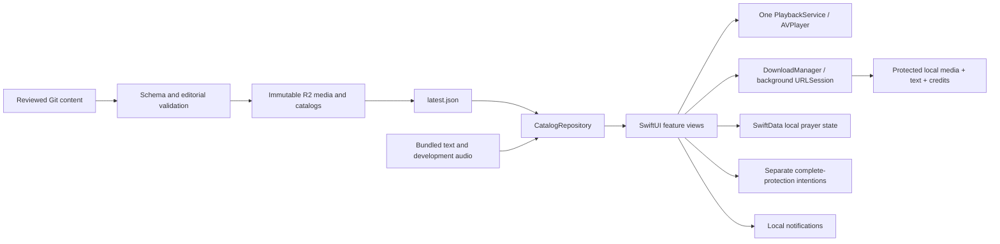

# Architecture

## Platform boundaries

`GraceAtHandApp` owns one `AppServices` composition root. Feature views receive it through the SwiftUI environment; no feature creates a player or network client. `GraceCore` is a local Swift package containing Codable contracts, validation, local-date rules, Rosary steps, quiet-hours rules, and revision-aware resume logic. The app target contains platform services and reusable SwiftUI components. These are intentionally small modules inside the target; there are no external runtime packages.

## Navigation and presentation

Today, Discover, Scripture, and My prayer each retain a navigation path. Compact layouts use a native tab bar; regular iPad layouts use sidebar/detail navigation with a single active detail stack. `NavigationMemory` retains destination scroll offsets, search filters, and the chosen Scripture date when that stack changes. The full player is a sheet over the originating navigation context. Reading surfaces are opaque; the mini-player offers a solid alternative when Reduce Transparency is enabled. Reading uses scaled system serif typography plus a separate persisted reading-size control. Increased contrast strengthens secondary text and borders through shared tokens.

Today’s featured prayer uses the locally selected interests and available time. Suggestions prefer prayers within the chosen duration, rank matching topics, and use the morning/evening prayer as a stable tie-breaker. When no prayer fits, the shortest available prayer is shown with its actual duration. Offline suggestions prefer retained downloads. These rules live in GraceCore; the complete library remains available in Discover.

## Persistence and privacy

SwiftData `LocalSchemaV1` stores favorites, passage snapshots, listening progress, completion, and settings. CloudKit is explicitly disabled. The versioned migration plan starts at V1; any next schema requires an actual migration and a retained V1 fixture test. Opening an unreadable store never silently erases it.

All app-managed data directories are excluded from cloud backup. Private intentions live in a separate JSON file with `NSFileProtectionComplete`; UI data is cleared when protected data becomes unavailable. A native window cover obscures content, including open editors, while the app is inactive. Other local records and downloaded audio use protection after first unlock so locked-screen audio can continue. Intentions never enter network requests, analytics, notifications, or diagnostic reports. Permission previews contain neutral text.

Downloads are durable user choices under Application Support, separate from URLSession temporary transfer files and purgeable system caches. The record contains the prayer's text, transcript, credits, and media revision. Completion checks byte count and SHA-256, then moves the file into place. An update retains the previous file until the replacement verifies. Cancellation, retry, deletion, and restart reconciliation have explicit states.

Favorites are keyed by stable content ID. Audio resume is keyed by asset revision; changed audio resets position. A withdrawn item is removed from downloads on successful catalog refresh and stops current playback. Catalog and generation are persisted together in one atomic cache envelope. A failed refresh never applies withdrawals or destroys the previous library. Offline devices cannot receive immediate corrections or withdrawals.

An unreadable download index blocks record mutations and reconciliation writes until loading succeeds. Downloads offers an explicit retry or confirmed reset; startup never replaces unreadable metadata with an empty library. A retained recording is selected together with its matching text, credits, and resume revision until its replacement verifies. Resetting local data immediately reapplies default transfer and reminder policies to the running services.

## Personal practice and private writing

`PracticeDocument` in GraceCore defines routines, goals, dated sessions, journal entries and content connections. `PracticeRules` counts distinct prayer days within explicit Monday–Sunday weeks; morning is 05:00–12:00, midday 12:00–17:00, and evening includes the night. Sessions retain the local Gregorian day and period where they happened so travel does not rewrite history. Manual entries can be backfilled, edited, or deleted. Streaks are optional and disabled by default; hiding calendar/progress is independent of retaining activity. Disabling Keep prayer activity clears recorded activity and listening progress; routines, goals and writing remain.

`PracticeStore` uses a separate versioned, atomic JSON file in `PrivatePractice`, with complete file protection and backup exclusion. The existing SwiftData V1 schema is unchanged. Unsupported or unreadable practice data blocks mutations until a successful retry or an explicit confirmed reset; it is never silently replaced. `PrayerIntention` decodes original records with defaults for added tags, status, follow-up date and dated updates. Journal and intention search stays in memory; neither writing nor search is sent to diagnostics or networking.

Audio completion events use a playback-session UUID for idempotency. User-marked reading, routine steps, completed silence timers, and manual entries produce dated activity. Incomplete listening does not become a completed prayer day. Completion metadata received while private storage is locked is held in memory and written after unlock; process termination before unlock can lose that pending completion. Writing itself is cleared from the store and editor hierarchy on locking. Routines open one prayer at a time, and do not introduce automatic queues or scheduled notifications; prayer reminders remain an explicit independent choice.

Intention follow-ups are explicitly requested, limited to ten upcoming notifications alongside the existing prayer reminders, moved out of quiet hours, and cancelled when removed or marked answered/archived. Only an opaque intention UUID and neutral wording enter the notification request. Notification permission is requested when saving a chosen follow-up. Refreshing or editing quiet hours reconciles pending follow-ups after private data is available.

Journal and intention exports preview a readable text representation, then use an explicit share action or the system text-file exporter. The app keeps no plaintext export file cache. Exported copies intentionally leave the app's protection. Bulk and individual deletion do not delete the source prayer, routine, or connected writing.

Before a privacy lock removes the editor hierarchy, a journal editor retains unfinished nonempty writing as a protected draft. Drafts appear in the journal after unlock, override the displayed entry without overwriting its last saved version, and can be saved or discarded. Journal deletion and full reset also remove drafts. Process termination or storage failure can still interrupt an unsaved editor; no cloud recovery is implied.

`AppLockService` stores only the optional enabled setting outside the complete-protection writing store, excluded from backup. Enabling and disabling require `LocalAuthentication.deviceOwnerAuthentication`, permitting biometrics or the device passcode. A cold launch starts locked when enabled, and background/device locking invalidates pending authentication. The app recreates private view state after locking, including editors and export previews. The existing window cover obscures inactive snapshots. Audio service and after-first-unlock media access continue independently. This is an access gate, not a claim of separate app-password encryption; device protection and real authentication routing require hardware acceptance.

## Audio

One AVPlayer is owned for the application lifetime. The service manages AVAudioSession, lock-screen metadata, remote play/pause/seek/skip, playback speed, route changes, interruptions, stalled playback, and sleep timer. Resume after relaunch is paused. A downloaded file is verified before use. A changed URL/revision rebuilds the item instead of continuing a stale stream.

The silence timer stores an absolute deadline, so suspension does not make a tick counter drift. Optional completion notifications are scheduled only after permission is chosen. Recurring prayer reminders use local weekday/time triggers, quiet-hour validation, neutral text, and a snooze time moved outside quiet hours.

## Environments

| Xcode configuration | Data and network |
| --- | --- |
| Debug / Release | Bundled development catalog; no credentials |
| Preview | Local HTTP catalog at 127.0.0.1:8787; simulator only |
| Staging | Owned HTTPS content base, configured locally |
| Production | Reviewed bundled catalog plus owned HTTPS delivery; release gate rejects fixtures and missing identity |

`Local.xcconfig` is ignored. No R2 or GitHub secret is ever embedded in the app. Publication credentials belong only to the protected publishing job. Support links require HTTPS configuration and a StoreKit USA storefront; an unknown storefront hides the action. Support never conveys an entitlement or app activity.

## Future clients

Android and web consume `shared/content-schema/catalog.schema.json` and `shared/design-tokens/tokens.json`. Public IDs, revisions, date-only assignments, credits, media hashes, and optional timing cues have no Swift-specific representation. Native persistence is intentionally not the public API. Add client applications only when their work begins.
